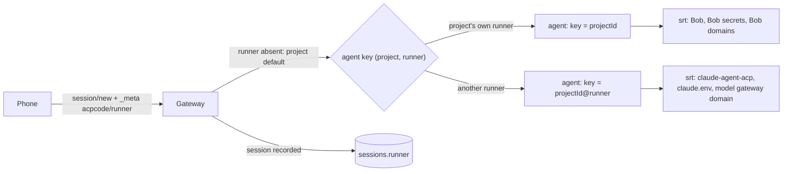

# Architecture

Read with [SPEC.md](SPEC.md). Decision IDs (D-n) refer to [DECISIONS.md](DECISIONS.md).

## 1. Layers

| Layer | Component | Job | Folder |
| --- | --- | --- | --- |
| Edge | Caddy | Terminate TLS. Require a client certificate (mutual TLS). Forward to loopback. | `deploy/Caddyfile` |
| Gateway: admission | `server.go`, `auth.go` | Reject before upgrade: Origin, rate limit, token, capacity. | `gateway/internal/server/` |
| Gateway: protocol guard | `guard.go`, `jsonv` | One JSON object per message; `cwd` inside roots; size caps; re-serialized as one line. | `gateway/internal/` |
| Gateway: agent control | `agent.go`, `runner.go`, `supervisor.go`, `client.go` | One agent per project and runner (host, podman, apple or srt runner, a lock per runner), id remapping, routing by cwd and sessionId, per-socket send queues. | `gateway/internal/server/` |
| Gateway: config and audit | `config`, `audit` | Validate the config file; one JSON audit line per event on stderr. | `gateway/internal/` |
| Gateway: sessions (phase 3) | `projects.go`, `store`, `subscribe.go`; approvals and idle close planned | Project registry, event log, subscribe and replay (D-028), approval queue, idle close. | `gateway/internal/server/`, `gateway/internal/store/` |
| Gateway: project data (phases 3, 5, 6) | `git.go`, `gitexec.go`, `snapshot.go`, `watch.go`; planned `files/`, `mcp/`, `skills/` | Read-only git (D-034, D-035); later signed file URLs, MCP and skill config. | `gateway/internal/server/` |
| Gateway: notify (phase 3) | `push/`, `push_deliver.go` | APNs payloads (D-038), token-based auth, HTTP/2 send, cleanup and retry (D-053); triggers and suppression (D-054). | `gateway/internal/push/`, `gateway/internal/server/` |
| Project runtime | One container per project and runner | Run `bob acp` (or another runner's agent) and git as the project user. Podman on Linux, Apple `container` on a Mac (D-079), or `srt` processes on a Mac (D-122, a weaker boundary). | `deploy/` (planned); Mac: `docs/MAC-SETUP.md` |
| App: transport | `ACPCodeTransport` (one WebSocket client, D-017), wrapped by `ACPClient` and `AppServerClient` | WebSocket, TLS, SPKI pinning, client certificate, 16 MiB message cap, connect timeout. | `ACPCodeTransport/`, upstream folders |
| App: security | Keychain store | Tokens, client identity, MCP headers. | `ACPCode/Security/` (new) |
| App: features | Home, Git, Preview, MCP, Skills screens | UI for the gateway features. | `ACPCode/Fork/` (new) |

Rule: new app code goes in new files under `ACPCode/Fork/` and `ACPCode/Security/`. Edits to upstream files stay small hooks (D-005).

## 2. Data flows

### 2.1 Connect and admission (phase 1)

```
Phone ──TLS + client cert──▶ Caddy :8443 ─▶ Gateway 127.0.0.1:8788  (HTTP upgrade request)
                               │                 │
                     no/invalid cert         1. Origin header?        ── yes ─▶ 403, close
                     ─▶ TLS alert              2. address locked out?  ── yes ─▶ 429, close
                                               3. token hash match?    ── no ──▶ 401, count failure, close
                                               4. under connection cap? ── no ──▶ 429, close
                                               5. upgrade (no agent yet; agents start per project on a routed request, D-025)
```

No agent process starts during admission. Every reject writes one audit line.

### 2.2 Message path and guard (phase 1)

```
Phone message ─▶ size ≤ maxMessageBytes? ── no ─▶ close 1009
             ─▶ exactly one JSON object?  ── no ─▶ close 1007
             ─▶ has params.cwd?           ── yes ─▶ realpath inside a root? ── no ─▶ JSON-RPC error -32602 to phone (not forwarded)
             ─▶ write line to agent stdin ─▶ stdin full? ── yes ─▶ pause socket until drain

Agent stdout line ─▶ length ≤ maxMessageBytes? ── no ─▶ drop, audit, close 1009
                  ─▶ valid JSON?               ── no ─▶ drop (agent log noise), audit
                  ─▶ send to phone ─▶ phone slow (buffer > max)? ── yes ─▶ pause agent stdout
Agent exits ─▶ pending requests get JSON-RPC -32000 "agent exited"; sockets stay open; next request starts a new agent after the exit (D-025)
Phone closes ─▶ the project's agent keeps running (D-025; D-006 superseded)
Phone slow (send queue over 2 × maxMessageBytes + 1 MiB) ─▶ close that socket 1013
```

### 2.3 Turn while the phone is away (phase 3)

```
Phone A ─prompt─▶ Gateway ─▶ bob acp (project container)
Phone A disconnects                       │
                                          ├─ session/update ─▶ event log (seq n, n+1, …)
                                          ├─ session/request_permission ─▶ approval queue
                                          │        └─▶ APNs push "approval needed"
Phone A or B reconnects ─▶ subscribe(afterSeq = last seen) ─▶ replay n…head ─▶ live stream
Phone answers ─▶ queue: first answer wins ─▶ response to bob
                └ second answer ─▶ "answered elsewhere"
No answer by timeout ─▶ queue selects a reject option (or `cancelled` if the request has none) ─▶ bob
```

Lifecycle (FR-45, D-016): a project's container starts on its first request (about 1.5 s until an existing session is loaded, RESULTS 2026-11-06) and stops after every session is idle for the idle time. A pending approval or a subscriber keeps it running. A request during a stop waits for the exit, then starts a new container with the same name. Files and `HOME` live on volumes, so Bob still has its sessions.

Failure path: the agent process dies. The gateway marks its sessions `error`, logs an event, and restarts the agent on the next request. After a restart, and only then, it forwards one `session/load` for a session the phone opens, keeps the agent's replay out of the log, and holds other requests for that session until a fence shows the replay is over (FR-20, F-12, D-029). A load or resume for a session that is live is answered by the gateway from its cached result and the log. Reason: a load on a live session is refused while a turn runs, and when idle it rebuilds Bob's session (MCP servers restart, F-19) and replays history that would enter the event log twice. The new agent starts only after the old process has exited, so two Bob processes never share a task store (F-21, D-014).

### 2.4 Read-only git (phase 3)

```
Phone ─git/status─▶ Gateway ─▶ container exec (project user):
                                 git --no-pager --no-optional-locks
                                     -c core.fsmonitor=false -c core.hooksPath=/dev/null
                                     status --porcelain=v2 --branch -z
                               env: GIT_CONFIG_NOSYSTEM=1 GIT_TERMINAL_PROMPT=0
                               timeout 5 s ─▶ kill, error "git timeout"
                               output > cap ─▶ truncate, truncated:true
Phone ─git/diff(path)─▶ path in last status? ── no ─▶ error
                      ─▶ git … diff --no-ext-diff --no-textconv -- <path>
                      ─▶ path on deny-list? ── yes ─▶ name only, content hidden
```

Turn snapshot (D-036): list the files, hash them with `git hash-object --no-filters -w`, build a temporary index with `git update-index --index-info`, then `git write-tree`, at turn start and turn end. It never runs `git add`, so no clean filter runs (T-27); git still runs in the container.

### 2.5 File preview (phase 5)

```
Phone ─files/url(path)─▶ Gateway: path syntax, deny-list, realpath inside project root, regular file? ── no ─▶ error
                                 ─▶ HMAC-SHA256 token {projectId, path, expiry} on the files host, expires ≤ 300 s (D-061)
Phone WKWebView / image loader ─▶ files host (Host header) ─▶ verify MAC + expiry ── fail ─▶ 403
                                 ─▶ check the path again: realpath inside root, not secret, same file as the open descriptor (D-063)
                                 ─▶ headers: nosniff, no-store, inline, CSP for HTML; GET and HEAD only (D-062)
```

The preview host is a different hostname from the ACP endpoint. Only a request whose Host is the files host reaches the file handler, and an upgrade there gets 403, so a hostile page cannot reach the ACP socket or its cookies. The check is repeated at each serve, so a symlink changed after signing is refused.

### 2.6 MCP and skill files (phase 6)

```
Phone ─mcp/list, mcp/set, skills/*─▶ Gateway: D-063 path rules (realpath inside project or home, no link, size cap)
                                       ─▶ read or atomic write on the host: <project>/.bob/mcp.json,
                                          <home>/.bob/settings/mcp.json, <project>/.bob/skills/<name>/SKILL.md (no exec)
Phone ─session/new, session/resume (mcpServers)─▶ Gateway: list kept in memory per live session (D-088, D-088a)
```

- **Host-path rule (D-085, D-085a).** The gateway reads and writes Bob's config and skill files directly on the host, through the project folder and the home (bind mounts). It never runs `container exec` for them, and a write needs no container start. Modes: 0600 for `mcp.json`, 0644 for `SKILL.md`.
- **Phone-owned list (D-084).** The phone owns the MCP server list and sends it in `session/new` and `session/resume`. The gateway never writes an HTTP server into a file. `_acpcode/mcp/set` only changes `disabled`, and `alwaysAllow` per D-089, on servers already in a file.
- **Kept per session (D-088, D-088a).** The gateway keeps the list the phone last sent for each live session, in memory only, and sends it on its own load after an idle stop or restart. It is dropped when the phone closes or deletes the session, or the gateway stops. A changed list reaches a live session only on a new session or reload (RESULTS 2026-11-07, Phase 6A).
- **Container reachability.** An HTTP MCP server for a container-run agent must listen on an address the container can reach, not loopback on the Mac. The Apple container check (RESULTS 2026-11-07) used the Mac's LAN address. See [MAC-SETUP.md](MAC-SETUP.md) section 9.
- **URL rule (`mcp_guard.go`).** https to any host; http to a loopback host only.

### 2.7 Runner per session (phase 9, in progress)

Contract: `docs/design/per-session-runner.md`. D-125 supersedes the "fixed at creation" part of D-116, D-126 adds the Claude Code runner.

```
Phone ─session/new(cwd, _meta["acpcode/runner"]?)─▶ Gateway
        runner id absent or empty ─▶ the project's runner (projects.runner, the project's default)
        runner id not in the config ─▶ JSON-RPC error -32602 (not forwarded)
        agent key = (project, runner)
            the project's own runner ─▶ key "<projectId>"          container "acpcode-<projectId>"
            any other runner         ─▶ key "<projectId>@<runner>"  container "acpcode-<projectId>-<runner>"
        no agent for the key? ─▶ start one: runner command, runner's secrets file, runner's domains and read paths
        session/new succeeds ─▶ record sessions.runner, only when it differs from the project's runner
Phone ─prompt, subscribe, load for an existing session─▶ route by sessions.runner, else the project's runner
```

- **Agent key.** The key for the project's own runner is the project id, so code that looks up a project's agent still finds the default one. Another runner uses `<projectId>@<runner>`. Two runners may run in one project at once, each with its own process.
- **Lock and names.** The lock file is per runner (`<home>/.acpcode-<runner>.lock`), so two runners in one project do not collide. Container names (podman, apple) are `acpcode-<projectId>` for the project's own runner and `acpcode-<projectId>-<runner>` for another. `HOME` stays per project.
- **Whole-project actions.** Stop, state, idle stop and shutdown reach every agent of a project.
- **Session records.** `sessions.runner` is NULL when the session uses the project's runner (schema 11). `_acpcode/sessions/index` returns the effective runner on each row.



### 2.8 Separate worktree (phase 9, in progress)

```
Phone ─_acpcode/projects/createWorktree {projectId, runner?}─▶ Gateway
        project is a git repository with a commit? ── no ─▶ -32602
        project is itself a worktree project?     ── yes ─▶ -32602
        runner kind is srt?                       ── no ─▶ refused
        git worktree add -b acpcode/<runner>/<8 hex> <parent path>-<runner>-<8 hex>   (from the parent's current HEAD)
        register child project: parent_id = parent, branch = acpcode/<runner>/<8 hex>, runner = chosen runner
        ─▶ result: the child project object
Phone ─session/new(cwd = child path, _meta["acpcode/runner"])─▶ the child's agent, in the sibling folder
```

- **Optional.** The app makes a worktree only when the person ticks "Separate worktree". Otherwise the session uses the project folder.
- **Sibling folder.** The path is the parent's path plus `-<runner>-<8 hex>`, inside the same project root, so the cwd rule (FR-6) holds with no new root.
- **Child project.** It is listed like any project, with `parentId` and `branch`. Its name is `<parent name> (<runner name>)`. A worktree project cannot have a worktree.
- **Sandbox allowances (srt only).** A worktree's git directory is `<parent>/.git/worktrees/<name>`, outside the worktree folder, and its objects are in the parent's `.git`. Under srt the agent's write list for a worktree project is widened by: the worktree's own git directory; and, in the common git directory, `objects`, `refs`, `logs` and `packed-refs`. `hooks` and `config` are never writable (D-122), so the agent still cannot plant a program that git or the person runs later. The parent's working files stay unwritable for the child's agent, apart from those git paths.
- **Merge.** The gateway never merges. The person merges the branch back, for example with `git merge acpcode/<runner>/<8 hex>` in the parent.

### 2.9 Runner secrets and domains (phase 9, in progress)

Each runner entry may carry `secretsFile`, `allowedDomains` and `allowRead` (D-126). At config load, an absent `allowedDomains` or `allowRead` takes the shared `runner` value, and the result is held on the `AgentRunner`. The runner side reads them only from there.

- **Secrets file.** Absolute, a regular file, no group or other access (0600), and it never sets `HOME` or `PATH`. Its names must be in the runner's `envPassthrough`. The gateway passes the values in the process environment, never in argv, a settings file or a log (D-083).
- **Claude Code runner.** `claude-agent-acp` runs the `claude` CLI. Its file holds `ANTHROPIC_AUTH_TOKEN` (the secret), and the non-secret `ANTHROPIC_BASE_URL`, `ANTHROPIC_MODEL`, `CLAUDE_CODE_DISABLE_EXPERIMENTAL_BETAS` and `CLAUDE_CODE_EXECUTABLE`. Under srt it may reach only `model-gateway.example.com`.
- **Bob next to it.** Bob's key and hosts stay in Bob's entry. A runner does not see another runner's secrets file or hosts.

## 3. Trust boundaries

1. Internet to Caddy: only clients with a certificate from your client CA pass.
2. Caddy to gateway: loopback only. The gateway trusts `X-Forwarded-For` only when `trustProxy` is true and the peer is loopback, and then uses only the last entry, which the proxy wrote.
3. Gateway to agent: the agent is untrusted output. Its lines are size-capped and parsed. It runs as another user in a container, or under `srt` with a Seatbelt profile (D-122). Each runner gets only its own secrets and hosts (D-126).
4. Repository content: untrusted. It can carry git config that runs programs (F-20).
5. Agent HTML and images: untrusted. Sandboxed in the app (FR-37, FR-39).

## 4. Design choices

- Go gateway with one dependency, `coder/websocket`, checked by a wire-level test suite in Node. See D-021, which supersedes D-001.
- ACP on the wire, plus `_acpcode/*` methods. See D-002.
- Mutual TLS at Caddy and hashed bearer tokens at the gateway. See D-003.
- Phases ordered so that no-credential work comes first; sessions and git are built against a fake agent. See D-004.
- Gateway lives in `gateway/` in the fork. See D-005.
- Phase 1 keeps one agent per connection; phase 3 moves to one per project. See D-006.
- Event log in SQLite through `modernc.org/sqlite`, WAL, `synchronous=NORMAL`, in `gateway/internal/store`. See D-023, which supersedes D-007.
- Git and Bob run in the project container. See D-008.
- A runner is chosen per session, and an agent is keyed by (project, runner). See D-125, which supersedes the "fixed at creation" part of D-116.
- Claude Code runs as a runner through `claude-agent-acp`, with per-runner secrets and domains. See D-126.
- The gateway never approves. See D-009.
- The overlay replaces `CLAUDE.md` and leaves the upstream `README.md`. See D-010.
- The shared `.claude/` files are tracked in git. See D-011.
